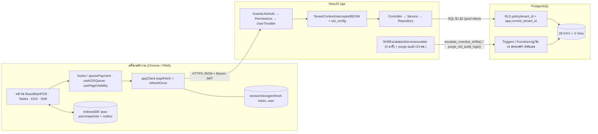
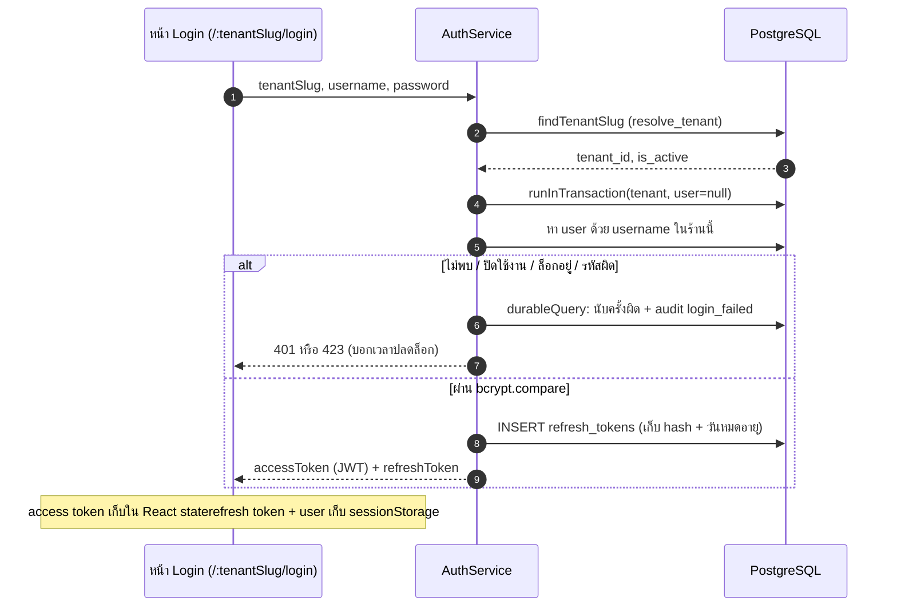
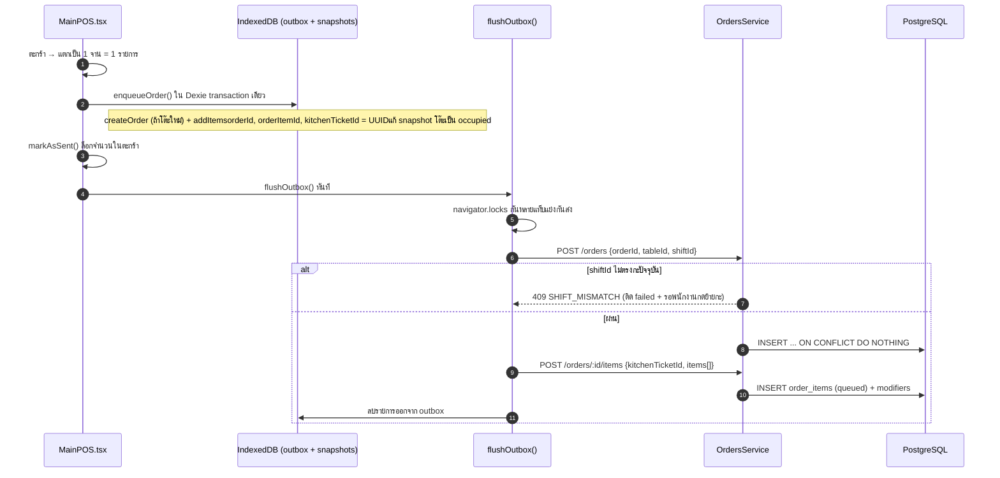
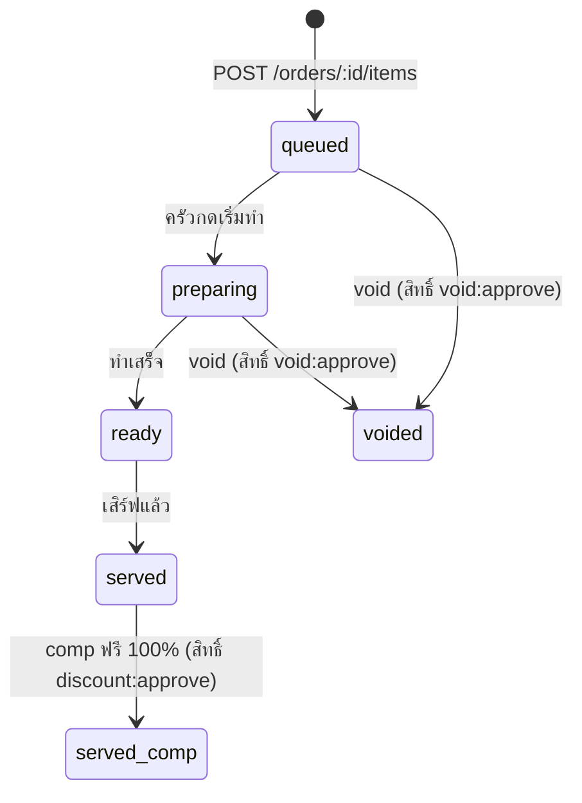
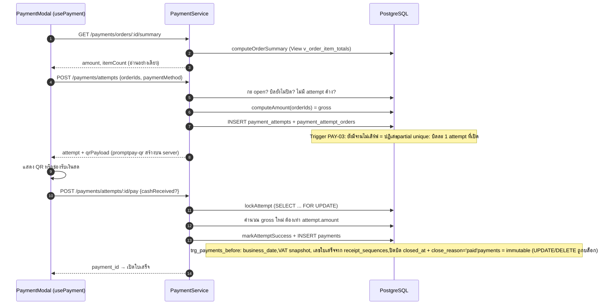

# Data Flow — PWA-POS (ค้าคล่อง / KhaKhlong)

> อัปเดตล่าสุด: **3 พฤศจิกายน 2569** · branch `feat-aod`
> สถาปัตยกรรม: React + Vite + Dexie v2 (IndexedDB) · NestJS 11 + raw `pg` · PostgreSQL 18 + RLS + Triggers

---

## สารบัญ

- [00 · ภาพรวม 4 ชั้นของข้อมูล](#00--ภาพรวม-4-ชั้นของข้อมูล)
- [01 · โครงสร้างร่วมของทุก Request (Pipeline)](#01--โครงสร้างร่วมของทุก-request-pipeline)
- [02 · เข้าสู่ระบบและการระบุร้าน (Auth & Tenant Flow)](#02--เข้าสู่ระบบและการระบุร้าน-auth--tenant-flow)
- [03 · การเปิดกะ (Shift Open Flow)](#03--การเปิดกะ-shift-open-flow)
- [04 · การสั่งอาหาร & คิวส่งครัวออฟไลน์ (Order & Outbox Flow)](#04--การสั่งอาหาร--คิวส่งครัวออฟไลน์-order--outbox-flow)
- [05 · จอแสดงผลในครัว (KDS Flow & Page Visibility)](#05--จอแสดงผลในครัว-kds-flow--page-visibility)
- [06 · การชำระเงินและออกใบเสร็จ (Payment Flow)](#06--การชำระเงินและออกใบเสร็จ-payment-flow)
- [07 · การปิดกะ การย้ายโต๊ะ และนับสต็อก (Closing & Inventory)](#07--การปิดกะ-การย้ายโต๊ะ-และนับสต็อก-closing--inventory)
- [08 · การอ่านข้อมูล รายงานยอดขาย และ Audit Logs](#08--การอ่านข้อมูล-รายงานยอดขาย-และ-audit-logs)
- [09 · แผนที่การจัดเก็บข้อมูล (Data Storage Lifecycle)](#09--แผนที่การจัดเก็บข้อมูล-data-storage-lifecycle)
- [10 · การตรวจสอบและแก้ไขจุดเสี่ยง (Security & Edge Cases Hardening)](#10--การตรวจสอบและแก้ไขจุดเสี่ยง-security--edge-cases-hardening)

---

## 00 · ภาพรวม 4 ชั้นของข้อมูล

หลักคิดสำคัญของระบบคือ **Server เป็นเจ้าของความจริง (Single Source of Truth)** เครื่องพนักงานเก็บเฉพาะภาพจำล่าสุด (*Snapshot*) และคิวรายการที่กำลังส่ง (*Outbox*) โดยกฎความปลอดภัยและกฎการเงินถูกบังคับซ้ำที่ระดับฐานข้อมูลผ่าน RLS และ PostgreSQL Triggers เสมอ

- **Server = ความจริง**: ยอดเงิน อัตราภาษี ค่าบริการ ราคา และเลขใบเสร็จ คำนวณบน Server และ DB Trigger เท่านั้น ไม่รับยอดคำนวณจากฝั่ง Client
- **1 Request = 1 Transaction**: `TenantContextInterceptor` เปิด `BEGIN` ครอบตลอดคำขอ หากมี error กลางทางจะ `ROLLBACK` ทั้งหมดทันที
- **แยกข้อมูลร้านด้วย RLS**: ข้อมูล Tenant ผูกติดมาจาก JWT ไม่ใช่จาก URL Parameters
- **UUID สร้างจากฝั่ง Client**: คำสั่งสั่งอาหารและจานอาหารมี UUID ตั้งแต่ตอนหย่อนลงคิว Outbox ส่งซ้ำกี่ครั้งก็ปลอดภัยด้วย `ON CONFLICT DO NOTHING`

---

## 01 · โครงสร้างร่วมของทุก Request (Pipeline)

ทุกคำขอในระบบวิ่งผ่านท่อมาตรฐานเดียวกัน (เช่น `POST /api/orders/:id/items`):

1. **`apiFetch()` แนบ Bearer Token**: ดึง Access Token จากหน่วยความจำ (React State) หากพบ HTTP 401 ระบบจะเรียก `refreshOnce()` เพื่อขอ token ใหม่ผ่าน Refresh Token ก่อน retry อัตโนมัติ (`frontend/src/libs/appClient.ts`)
2. **Middleware ระดับ Application**: Helmet, Compression, Body Parser จำกัด 2 MB, Prefix `/api`, CORS (`backend/src/main.ts`)
3. **Guards เรียงลำดับปลอดภัย**:
   - `JwtAuthGuard`: ตรวจสอบความถูกต้องของ JWT และแกะ payload ใส่ลงใน `request.user`
   - `PermissionsGuard`: ตรวจสอบสิทธิ์กับ Cache ใน Memory (`deny by default`)
   - `UserThrottlerGuard`: ตรวจจับ Rate Limit ต่อผู้ใช้ `user:${tenantID}:${sub}` (300 req/min) เพื่อไม่ให้เกิดปัญหาแย่งโควตากันหลัง NAT Router ของร้านอาหาร (`backend/src/common/guards/user-throttler.guard.ts`)
4. **`TenantContextInterceptor` เปิด Transaction**:
   - ดึง Client จาก Connection Pool แล้วเริ่มคำสั่ง `BEGIN`
   - รัน `set_config()` แบบ Local 5 ค่า: `tenant_id`, `user_id`, `user_role`, `ip`, `device`
   - บันทึก Client เข้าสู่ `AsyncLocalStorage`
   - ตรวจสอบ `token_version` และ `is_active` ของ User ในฐานข้อมูลแบบ Realtime (หากถูกเพิกถอนจะตัดสิทธิ์ทันที)
5. **ValidationPipe**: คัดกรอง Field แปลกปลอมด้วย `whitelist` และ `forbidNonWhitelisted`
6. **Controller → Service → Repository**:
   - Service ถือกฎทางธุรกิจและแปลงข้อความ Error ทางเทคนิคของ DB เป็นภาษาไทย
   - Repository ประมวลผลคำสั่ง SQL ดิบด้วย Parameterized Query `$1, $2` ผ่าน `db.query()`
7. **PostgreSQL Execution (RLS + Triggers)**: กรอง Tenant อัตโนมัติด้วย RLS พร้อมตรวจสอบกฎธุรกิจซ้ำผ่าน Triggers
8. **Commit หรือ Rollback**: จบงานด้วย `COMMIT` หากมี Exception จะ `ROLLBACK` ทั้งก้อน และคืน Client เข้า Connection Pool เสมอ
   - *หมายเหตุ*: ฟังก์ชัน `durableQuery()` ใช้กับบันทึกสถิติความปลอดภัย (เช่น นับจำนวนครั้งที่ใส่รหัสผ่าน/PIN ผิด) ซึ่งจะแยก Transaction และ Commit ทันทีเพื่อไม่ให้ถูก Rollback หายไป

---

## 02 · เข้าสู่ระบบและการระบุร้าน (Auth & Tenant Flow)

### `POST /api/auth/login` (Public Route)

- **Store Finder**: เข้าสู่ระบบครั้งแรกผ่าน `/` ระบบค้นหาร้านจาก `GET /api/public/tenants/:slug` และบันทึก slug ไว้ใน `localStorage`
- **Security Definer Isolation**: การค้นหาร้านทำผ่านฟังก์ชัน `resolve_tenant` ที่มีสิทธิ์เฉพาะเจาะจง เมื่อได้ `tenant_id` จึงเปิด Context RLS เพื่อค้นหาผู้ใช้
- **Token Storage**:
  - `accessToken` (อายุตาม `JWT_EXPIRES_IN`): เก็บใน Memory (React State)
  - `refreshToken` (อายุตาม `REFRESH_EXPIRES_HOURS` ค่าเริ่มต้น 16 ชม.): เก็บใน `sessionStorage` เพื่อป้องกันความเสี่ยง XSS
  - `token_version`: เก็บใน DB เมื่อมีการรีเซ็ตรหัสผ่าน ค่าเวอร์ชันจะขยับ ทำให้ Token เดิมหมดสภาพทันที

---

## 03 · การเปิดกะ (Shift Open Flow)

### `POST /api/shifts` (`ShiftsService.openShift`)

1. พนักงานระบุเงินทอนตั้งต้น (Opening Cash)
2. ฐานข้อมูลคำนวณ `business_date` ผ่านฟังก์ชัน `compute_business_date()` อัตโนมัติ ป้องกันปัญหาวันที่เหลื่อมล้ำ
3. ตาราง `shifts` บังคับ Unique Constraint `(tenant_id, business_date)` 1 วันทำการเปิดได้เพียง 1 กะ
4. เครื่องลูกบันทึก Snapshot `currentShift` ลงใน IndexedDB เพื่อใช้อ้างอิงตอนออฟไลน์
5. **การตรวจจับ `SHIFT_MISMATCH`**: เมื่อส่งคำสั่งสั่งอาหาร ระบบจะตรวจสอบว่า `shiftId` ตรงกับกะปัจจุบันที่เปิดอยู่หรือไม่ หากไม่ตรงจะปฏิเสธด้วย 409 `SHIFT_MISMATCH` และแสดงปุ่ม "ย้ายเข้ากะปัจจุบัน" บน UI เพื่อป้องกันยอดขายไหลข้ามวันโดยไม่รู้ตัว

---

## 04 · การสั่งอาหาร & คิวส่งครัวออฟไลน์ (Order & Outbox Flow)

ทั้งโหมดออนไลน์และออฟไลน์ใช้เส้นทางเดียวกันผ่าน Outbox Queue ทำให้ระบบมีความทนทานสูงและทำงานได้อย่างต่อเนื่องแม้สัญญาณอินเทอร์เน็ตขาดหาย

### Outbox Guards & Data Integrity
- **บล็อกการชำระเงิน**: ปุ่มชำระเงินถูกปิดกั้น (`disabled={!canPay}`) ใน `OrderSidebar` ทันทีเมื่อมีรายการรอส่งครัว หรือมีรายการค้างใน Outbox (`outboxPendingCount > 0`)
- **บล็อกการรวมบิลคิดเงิน**: ปิดปุ่มรวมโต๊ะ (`canMergePay = false`) ใน `TablesPage` หากโต๊ะใดโต๊ะหนึ่งมี Outbox ค้าง
- **บล็อกการยกเลิกบิล / ปิดบิล Walkout / ย้ายโต๊ะ**: ใน `TableCard` จะถูก Disabled พร้อมข้อความเตือนให้เคลียร์คิว Outbox ก่อนเสมอ
- **จัดการ HTTP 429 ปลอดภัย**: ใน `flush.ts` หากติด Rate Limit จะคงสถานะเป็น `pending` และหยุดรอบนั้นเพื่อรอส่งใหม่รอบถัดไป ไม่ตัดเป็น `failed`
- **Atomic Discard**: เมื่อยกเลิกบิลใหม่ที่เปิดไว้ตอนออฟไลน์ทิ้งใน `OutboxPanel` ระบบจะคืนสถานะโต๊ะใน Snapshot กลับเป็น `available` อัตโนมัติ

---

## 05 · จอแสดงผลในครัว (KDS Flow & Page Visibility)

### `GET /api/kds/queue` · `PATCH /api/kds/items/:id/status`

1. **Page Visibility Management ([`usePageVisibility`](file:///c:/Users/chira/OneDrive/เดสก์ท็อป/Final-Project/PWA-POS/frontend/src/hooks/usePageVisibility.ts))**:
   - เมื่อพับแท็บหรือดับหน้าจอ (`isVisible === false`): **หยุด Polling ทันที (0 req/min)** ช่วยประหยัดแบตเตอรี่และลดภาระบน Server
   - เมื่อกลับมาเปิดแท็บ (`visibilitychange` + `focus` + `online`): ดึงข้อมูล silent refresh ทันที 1 รอบ พร้อม cooldown 1 วินาทีป้องกัน Double-Fetch แล้วเริ่มนับรอบ Polling 3 วินาทีใหม่
2. **Resilient UI**:
   - ป้ายสถานะบนหัวจอ: จุดสีเขียว `สด`, จุดสีส้มกระพริบ `กำลังอัปเดต...`, จุดสีเทา `พักหน้าจอ`
   - หากเกิดข้อผิดพลาดในการเชื่อมต่อระหว่าง Silent Refresh ระบบจะไม่ทำลายหน้าจอทิ้ง แต่จะแสดงแถบเตือนสีอำพันนวลตาด้านบนและคงตั๋วเดิมไว้ให้คนครัวทำอาหารได้อย่างต่อเนื่อง
3. **อัปเดตสถานะรายจาน**: ครัวสามารถกดเปลี่ยนสถานะทีละจานหรือทั้งตั๋วได้ โดย DB Trigger `trg_order_item_state` จะคอยควบคุมลำดับขั้นของสถานะอาหาร

---

## 06 · การชำระเงินและออกใบเสร็จ (Payment Flow)

### `PaymentModal` → `/api/payments/*`

- **จองบิล 2 จังหวะ (Attempt & Pay)**: ล็อกบิลและยอดเงินก่อน จากนั้นจึงบันทึกการรับเงินจริง
- **ความไม่เปลี่ยนแปลงของข้อมูล (Immutability)**: ตาราง `payments` ถูกติดตั้ง Trigger บล็อกคำสั่ง `UPDATE` และ `DELETE` ถาวร
- **ใบเสร็จและการพิมพ์ซ้ำ**: รองรับกระดาษความร้อน 80mm ผ่าน `features/receipt/` โดยการพิมพ์ครั้งที่ 2 ขึ้นไปจะประทับป้าย "สำเนา" ตาม `isCopy` และควบคุมเพดานการพิมพ์ซ้ำตามค่า `max_reprints`

---

## 07 · การปิดกะ การย้ายโต๊ะ และนับสต็อก (Closing & Inventory)

### การปิดกะ (Close Shift)
- ตรวจสอบยอดเงินจริง `actual_closing_cash` กระทบยอดกับ `expected = opening + cash_sales + cash_in − cash_out`
- บล็อกการปิดกะเด็ดขาดหากยังมีบิลค้างที่ยังไม่ปิด (`closed_at IS NULL`)
- หากยอดเงินไม่ตรง กะจะเข้าสู่สถานะ `pending_verification` รอผู้จัดการ/เจ้าของร้านตรวจสอบด้วย PIN
- **Cron Jobs อัตโนมัติใน [`ShiftEscalationService`](file:///c:/Users/chira/OneDrive/เดสก์ท็อป/Final-Project/PWA-POS/backend/src/common/shift-escalation.service.ts)**:
  - Escalate กะที่ค้างตรวจเกินเวลา: รันฟังก์ชัน `escalate_overdue_shifts()` ทุก 5 นาทีผ่าน `referenceQuery()`
  - Purge ข้อมูล Audit Logs เก่า: รันฟังก์ชัน `purge_old_audit_logs()` (ลบข้อมูลเกิน 1 ปี) วันละ 1 ครั้ง

### การย้ายโต๊ะ (Move Table Flow)
- สามารถย้ายโต๊ะของบิลที่เปิดอยู่ได้ผ่านปุ่ม "ย้ายโต๊ะ" บนเมนูของการ์ดโต๊ะ
- บล็อกทันทีเมื่อโต๊ะต้นทางมี Outbox ค้าง หรือเครื่องกำลังออฟไลน์
- หน้าต่าง [`MoveTableModal`](file:///c:/Users/chira/OneDrive/เดสก์ท็อป/Final-Project/PWA-POS/frontend/src/features/tables/components/MoveTableModal.tsx) จะกรองเฉพาะโต๊ะว่าง (`available`) ที่ไม่มี Outbox ค้างในเครื่องนี้ พร้อมตัวกรองตามชั้น
- ยิง API `PATCH /api/orders/:id/move-table` (สิทธิ์ `order:create`) และอัปเดตสถานะโต๊ะบนผังร้านทันที

### การนับสต็อก (Stock Count)
- นับสต็อกสิ้นวันผ่านฟังก์ชัน `record_stock_count()` โดยบันทึกส่วนต่างลงตาราง `inventory_transactions` แบบ Ledger Append-only ไม่มีการแก้ไขยอดคงเหลือตรง ๆ

---

## 08 · การอ่านข้อมูล รายงานยอดขาย และ Audit Logs

- **รายงานยอดขาย (`saleReport`)**: รวมยอดจากตาราง `payments` ตาม `business_date` มีตัวกรองช่วงวันที่ (From - To), โหมดดูกรองตามกะ (Shift Selector), และส่งออกตารางเป็นไฟล์ CSV พร้อม UTF-8 BOM
- **Audit Logs**: ตรวจสอบผ่าน `GET /api/audit-logs` (สิทธิ์ `audit_log:view`) สามารถค้นหาตามประเภทการกระทำ ผู้ใช้งาน และวันที่
- **รูปภาพเมนูอาหาร**: ฝั่ง Client ย่อรูปภาพผ่าน HTML5 Canvas ([`compressImageFile`](file:///c:/Users/chira/OneDrive/เดสก์ท็อป/Final-Project/PWA-POS/frontend/src/features/editMenu/components/menuFormPopup.tsx)) เป็น WebP/JPEG สูงสุด 600×450px (~20–60KB) และฝั่ง Backend จำกัดขนาดความยาวข้อความด้วย `@MaxLength(500000)` ใน DTO เพื่อประหยัดพื้นที่ฐานข้อมูลและให้โหลดใน PWA Offline ได้รวดเร็ว

---

## 09 · แผนที่การจัดเก็บข้อมูล (Data Storage Lifecycle)

| แหล่งจัดเก็บ | ข้อมูลที่จัดเก็บ | อายุการคงอยู่ | วัตถุประสงค์ |
|---|---|---|---|
| **PostgreSQL** | บิล, รายการอาหาร, เงิน, กะ, สต็อก, ผู้ใช้, audit logs | ถาวร (Audit logs ลบเมื่อเกิน 1 ปี) | แหล่งความจริงของระบบทั้งหมด |
| **IndexedDB (Snapshots)** | ผังโต๊ะ (`tables`), กะปัจจุบัน (`currentShift`), เมนูเต็ม (`menu`) | ถาวรในเครื่อง (เขียนทับเมื่อออนไลน์) | ให้อ่านข้อมูลเปิดบิลได้ทันทีตอนออฟไลน์ |
| **IndexedDB (Outbox)** | รายการสร้างบิลและส่งครัวที่ยังไม่ถึง Server | จนกว่าจะส่งสำเร็จ หรือกดยกเลิกทิ้ง | รองรับการทำงานแบบ Offline-first |
| **React State** | Access Token, ข้อมูลตะกร้าที่ยังไม่กดส่ง, คิว KDS ปัจจุบัน | สลายไปเมื่อรีเฟรชหน้าเว็บ | การแสดงผลและการตอบสนองของ UI |
| **sessionStorage** | Refresh Token (`pos_refresh`), ข้อมูลผู้ใช้เบื้องต้น | สลายไปเมื่อปิดแท็บเบราว์เซอร์ | ป้องกันการโจมตีผ่าน XSS |
| **localStorage** | Slug ร้านล่าสุด, การตั้งค่าเครื่องพิมพ์แยกตามร้าน | ถาวรต่อเครื่องเบราว์เซอร์ | ความสะดวกในการเข้าใช้งานครั้งถัดไป |

---

## 10 · การตรวจสอบและแก้ไขจุดเสี่ยง (Security & Edge Cases Hardening)

ตารางสรุปการปิดช่องโหว่ทางสถาปัตยกรรมทั้งหมดที่มีการแก้ไขเสร็จสมบูรณ์แล้วในโค้ดปัจจุบัน:

| ปัญหาความเสี่ยงเดิม | ระดับ | สถานะ | วิธีการแก้ไขในระบบปัจจุบัน |
|---|:---:|:---:|---|
| **Rate Limit ชนกันหลัง NAT Router** | HIGH | **แก้ไขแล้ว** | ใช้ `UserThrottlerGuard` นับโควตาตาม `user:${tenantID}:${sub}` (300 req/min) แทน IP ทำให้พนักงานและจอครัวทุกเครื่องในร้านไม่แย่งโควตากัน |
| **HTTP 429 ใน Outbox กลายเป็น Failed** | HIGH | **แก้ไขแล้ว** | ใน `flush.ts` จัด 429 เป็น Transient Error คงสถานะ `pending` ไว้รอ retry รอบหน้าอัตโนมัติ |
| **ชำระเงินขณะมี Outbox ค้าง** | MEDIUM | **แก้ไขแล้ว** | บล็อกปุ่ม `canPay = false` และ `canMergePay = false` พร้อมแสดง badge เตือน "รอส่ง n" |
| **`shiftId` ข้ามกะไม่ถูกตรวจ** | MEDIUM | **แก้ไขแล้ว** | ส่ง `shiftId` ไปกับ `POST /orders`, Backend ตอบ 409 `SHIFT_MISMATCH`, UI มีปุ่มย้ายกะ |
| **รูปเมนู Data URL ขนาดใหญ่เกินไป** | MEDIUM | **แก้ไขแล้ว** | บีบอัดรูปภาพฝั่ง Client ก่อนส่ง (~20–60KB) และ BE ล็อกเพดานความยาว `@MaxLength(500000)` |
| **การย้ายโต๊ะไม่ตรวจ Outbox ต้นทาง** | MEDIUM | **แก้ไขแล้ว** | พัฒนา `MoveTableModal` พร้อม Outbox Guard บล็อกทั้งโต๊ะต้นทาง โต๊ะปลายทาง และกรณีออฟไลน์ |
| **KDS Polling เปลืองโหลดขณะไม่ได้ใช้งาน** | LOW | **แก้ไขแล้ว** | ใช้ `usePageVisibility` หยุด Polling ทันทีเมื่อพับแท็บหรือล็อกหน้าจอ (0 req/min) |
| **Audit Logs เก่าไม่ถูก Purge** | LOW | **แก้ไขแล้ว** | เพิ่มคำสั่งรัน `purge_old_audit_logs()` วันละ 1 ครั้งใน `ShiftEscalationService` |
| **Refresh Token ใน `sessionStorage`** | LOW | **ตั้งใจคงไว้** | เป็น Architectural Decision เพื่อป้องกันความเสี่ยงจาก XSS |

---

> เอกสารนี้สะท้อนโครงสร้าง Data Flow และการทำงานของโค้ดจริงในโปรเจกต์ `PWA-POS` (ค้าคล่อง) ทุกกระบวนการผ่านการทดสอบ Build และ Type-check 100% เรียบร้อยแล้ว

