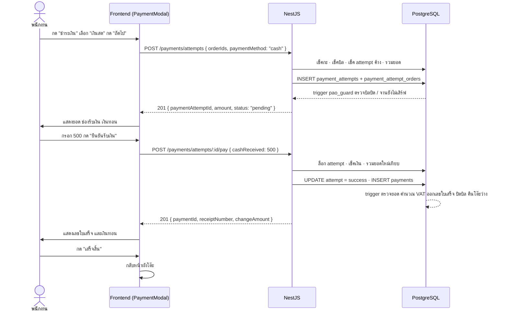

# Payment Module — คู่มือการทำงาน

อัปเดต: 2026-10-25 · อ้างอิงโค้ดจริงใน `backend/src/modules/payment/`, `frontend/src/features/mainpos/` และ `backend/src/database/FULL_INSTALL.sql`

เอกสารนี้อธิบายว่าการรับชำระเงินทำงานอย่างไรตั้งแต่พนักงานกดปุ่มจนบิลปิด ข้อมูลอะไรถูกส่งไปมา โค้ดแต่ละชั้นทำอะไร และฐานข้อมูลทำอะไรให้เอง

---

## 1. ภาพรวม

### 1.1 วิธีชำระที่รองรับ

| วิธี | ค่าในระบบ | ยืนยันรับเงินอย่างไร |
|---|---|---|
| เงินสด | `cash` | พนักงานกรอกจำนวนเงินที่รับมา ระบบคำนวณเงินทอน |
| QR PromptPay | `qr_code` | พนักงานตรวจว่าเงินเข้าแอปธนาคารของร้านแล้วจึงกดยืนยัน ระบบไม่ได้ต่อกับธนาคารหรือ payment gateway |

ไม่ใช้ Stripe หรือ gateway อื่น เหตุผลคือร้านเล็กส่วนใหญ่ใช้ QR PromptPay ของร้านเองอยู่แล้ว ไม่มีค่าธรรมเนียม และเงินเข้าบัญชีร้านโดยตรง ระบบไม่ต้องถือเงินแทนร้าน ข้อแลกคือระบบไม่มีหลักฐานอัตโนมัติว่าเงินเข้าจริง (ดูหัวข้อ 9)

### 1.2 ทำไมแบ่งเป็น "attempt" กับ "payment"

การชำระเงินมี 2 ขั้น และเก็บใน 2 ตารางต่างกัน (กฎ PAY-05)

| | `payment_attempts` | `payments` |
|---|---|---|
| เปรียบเหมือน | ใบแจ้งยอด | ใบเสร็จ |
| เกิดตอน | พนักงานเลือกวิธีจ่ายแล้วกด "ถัดไป" | พนักงานกด "ยืนยันรับเงิน" |
| สถานะ | `pending` · `success` · `failed` · `timeout` | ไม่มีสถานะ มีแล้วคือจ่ายสำเร็จ |
| แก้ได้ไหม | เปลี่ยนสถานะได้ครั้งเดียวจาก `pending` · ยอดและวิธีจ่ายแก้ไม่ได้ | แก้และลบไม่ได้เลย (immutable) |

ต้องแยกเพราะ
- **ล็อกบิลระหว่างรอเงิน** ตอนลูกค้ากำลังสแกน QR เครื่องอื่นต้องเปิดชำระบิลเดียวกันซ้ำไม่ได้ attempt ที่ค้างอยู่ทำหน้าที่จองบิลไว้
- **เก็บร่องรอยของรายการที่ไม่สำเร็จ** ลูกค้าเปลี่ยนใจหรือพนักงานยกเลิก attempt ยังอยู่ในตารางพร้อมเหตุผล
- **`payments` ต้องเป็นหลักฐานทางบัญชีที่แก้ไม่ได้** จึงสร้างเฉพาะเมื่อแน่ใจแล้วว่าได้รับเงิน

### 1.3 ใครคำนวณอะไร

| ตัวเลข | ใครคำนวณ |
|---|---|
| ยอดที่ต้องจ่าย (`amount`) | **NestJS** รวม `line_total` ของทุกจานที่ไม่ถูก void จาก view `v_order_item_totals` |
| ตรวจว่ายอดตรงกับรายการจริงในบิล | **Trigger** `trg_payments_before` ตอน INSERT `payments` |
| VAT (`vat_amount`) | **Trigger** ตาม `vat_mode` ของร้าน |
| เลขใบเสร็จ, วันทำการ | **Trigger** |
| เงินทอน (`change_amount`) | **DB** คอลัมน์ `GENERATED` = `cash_received - total_amount` |
| เงินทอนที่โชว์ระหว่างพนักงานพิมพ์ | **Frontend** ใช้แสดงผลเท่านั้น ตัวเลขจริงมาจาก server |

หน้าจอไม่คำนวณยอดเอง เพราะสูตรต้องตรงกับ trigger ทุกกรณี (จาน comp, จาน void, modifier, รวมหลายบิล) และข้อมูลในเครื่องอาจเก่า

---

## 2. ตารางที่เกี่ยวข้อง

| ตาราง / view | module นี้ทำอะไรกับมัน |
|---|---|
| `payment_attempts` | INSERT ตอนเริ่มชำระ · UPDATE สถานะตอนจ่ายหรือยกเลิก |
| `payment_attempt_orders` | INSERT แถวละบิล ผูก attempt กับบิล · คอลัมน์ `is_open` คือยังจองบิลอยู่หรือไม่ |
| `payments` | INSERT ตอนยืนยันรับเงิน |
| `receipt_print_logs` | INSERT ทุกครั้งที่พิมพ์ใบเสร็จ |
| `orders` | อ่านว่าบิลมีจริงและยังไม่ปิด · trigger ปิดบิลให้เมื่อจ่ายสำเร็จ |
| `dining_tables` | อ่านเลขโต๊ะสำหรับใบเสร็จ · trigger เปลี่ยนสถานะโต๊ะให้เอง |
| `v_order_item_totals` | อ่านยอดต่อจาน (ราคาเมนู + modifier, comp เป็น 0) |
| `v_receipt_lines` | อ่านบรรทัดใบเสร็จ (รวมจานที่เหมือนกันเป็นบรรทัดเดียว ไม่นับจาน void) |
| `tenants` | อ่านชื่อร้าน ที่อยู่ เลขผู้เสียภาษีสำหรับหัวใบเสร็จ |
| `users` | อ่านชื่อแคชเชียร์สำหรับใบเสร็จ |
| `shifts` | อ่านว่ามีกะเปิดอยู่ไหม (ผ่าน `ShiftsService.getCurrentShift()`) |
| `system_config` | trigger อ่าน `vat_mode`, `vat_rate`, `service_charge_rate`, `require_all_served_before_payment`, `max_reprints` |
| `receipt_sequences` | trigger ใช้ออกเลขใบเสร็จต่อวันทำการ |

---

## 3. Endpoint ทั้งหมด

ทุก endpoint ต้องมี JWT และสิทธิ์ `payment:receive` (Owner, Manager, Employee มีทุกคน) path จริงมี `/api` นำหน้าจาก `setGlobalPrefix('api')`

| Method | Path | `:id` คือ | ทำอะไร | สำเร็จ |
|---|---|---|---|---|
| POST | `/api/payments/attempts` | | เริ่มชำระ จองบิล ได้ยอดจาก server | 201 |
| GET | `/api/payments/attempts/:payment_attempt_id` | attempt | ดูสถานะและยอดของ attempt | 200 |
| POST | `/api/payments/attempts/:id/pay` | attempt | ยืนยันรับเงิน สร้างใบเสร็จ ปิดบิล | 201 |
| POST | `/api/payments/attempts/:id/cancel` | attempt | ยกเลิก attempt ปล่อยบิล | 201 |
| GET | `/api/payments/:id/receipt` | **payment** | ข้อมูลใบเสร็จครบสำหรับแสดงและพิมพ์ | 200 |
| POST | `/api/payments/:id/print` | **payment** | บันทึกการพิมพ์ใบเสร็จ 1 ครั้ง | 201 |

ระวัง: 4 ตัวแรกใช้ **`paymentAttemptId`** ส่วน 2 ตัวหลังใช้ **`paymentId`** (ได้จาก response ของ `/pay`)

รูปแบบ response สำเร็จทุกตัว: `{ "status": "success", "data": { ... } }` · ชื่อ field เป็น camelCase · ตัวเลขเงินเป็น number · ค่าที่ไม่มีเป็น `null`

---

## 4. Workflow หน้าร้าน

### 4.1 เส้นทางปกติ (เงินสด)



### 4.2 QR

เหมือนเงินสดทุกขั้น ต่างกันแค่
- ขั้นแรกส่ง `paymentMethod: "qr_code"`
- หน้ายืนยันแสดง QR และยอดแทนช่องกรอกเงิน
- พนักงานดูแจ้งเตือนในแอปธนาคารของร้าน เห็นเงินเข้าแล้วจึงกดยืนยัน
- `/pay` ส่ง body ว่าง `{}` ไม่ส่ง `cashReceived`
- ใบเสร็จมี `cashReceived` และ `changeAmount` เป็น `null` (QR ไม่มีเงินทอน เพราะยอดอยู่ใน QR แล้ว ลูกค้าโอนพอดีเสมอ)

### 4.3 ยกเลิกกลางทาง

ใช้เมื่อลูกค้าเปลี่ยนวิธีจ่าย (attempt แก้วิธีจ่ายไม่ได้ ต้องยกเลิกแล้วเริ่มใหม่) หรือยอดบิลเปลี่ยนไปหลังเริ่มชำระ

```
พนักงานกด "ย้อนกลับ" หรือปิดหน้าต่าง ระหว่างอยู่หน้ายืนยัน
  Frontend เรียก POST /payments/attempts/:id/cancel { reason }
  attempt กลายเป็น failed
  trigger ตั้ง is_open = false ให้ทุกบิลใน attempt นี้ บิลถูกปล่อย
  สร้าง attempt ใหม่กับบิลเดิมได้ทันที
```

บิลยังไม่ปิด (`orders.closed_at` ยังเป็น `null`) โต๊ะยังมีลูกค้า แค่ไม่มีการชำระค้างแล้ว

### 4.4 มี attempt ค้างจากเครื่องอื่น

พนักงาน A เปิดหน้าชำระแล้วปิดแท็บเล็ตทิ้งไป attempt ยังเป็น `pending` บิลถูกล็อก พนักงาน B มากดชำระบิลเดียวกัน

```
B กด "ถัดไป"
  API ตอบ 409 { code: "PAYMENT_ATTEMPT_PENDING", message, paymentAttemptId }
  หน้าจอขึ้นข้อความ พร้อมปุ่ม "ยกเลิกรายการที่ค้างแล้วเริ่มใหม่"
B กดปุ่ม
  Frontend เรียก cancel ด้วย paymentAttemptId ที่ได้จาก 409
  แล้วเรียก POST /payments/attempts ใหม่อัตโนมัติ
```

### 4.5 กดยืนยันซ้ำ หรือเน็ตสะดุด

`/pay` กับ attempt ที่ `success` แล้ว **ไม่สร้างใบเสร็จใหม่** แต่คืนใบเสร็จเดิม (เลขเดิม) ทำให้กดซ้ำได้อย่างปลอดภัย

---

## 5. รายละเอียดแต่ละ endpoint

### 5.1 `POST /payments/attempts` — เริ่มชำระ

**Request**
```json
{
  "orderIds": ["9f1c...uuid"],
  "paymentMethod": "cash"
}
```

| field | กติกา (`CreatePaymentAttemptDTO`) |
|---|---|
| `orderIds` | array ของ UUID · อย่างน้อย 1 · ไม่เกิน 10 · ห้ามซ้ำ · บิลเดียวส่ง 1 ตัว รวมโต๊ะส่งหลายตัว (PAY-01) |
| `paymentMethod` | `cash` หรือ `qr_code` |

**ไม่มี** `amount`, `paymentAttemptId`, `tenantId`, `initiatedBy` ใน body
- `amount` server คำนวณเอง ถ้า client ส่งมา `ValidationPipe` (`forbidNonWhitelisted: true`) ตอบ 400
- `paymentAttemptId` DB สร้างให้ (`gen_random_uuid()`)
- `tenantId` ใส่ด้วย `app_tenant_id()` ใน SQL · `initiatedBy` มาจาก JWT (`req.user.sub`)

**ลำดับใน `PaymentService.createPaymentAttempt`**

| ขั้น | ทำอะไร | ถ้าไม่ผ่าน |
|---|---|---|
| 1 | `ShiftsService.getCurrentShift()` ต้องได้กะสถานะ `open` | 409 `ไม่มีกะถูกเปิด` |
| 2 | `findOrders` อ่าน `order_id, closed_at` ของบิลทั้งหมด จำนวนต้องเท่ากับที่ส่งมา | 404 `ไม่พบบิลนี้` |
| 3 | ทุกบิลต้องมี `closed_at = null` | 409 `มีบิลที่ปิดไปแล้ว` |
| 4 | `findOpenAttempt` หา attempt ที่ยังจองบิลเหล่านี้อยู่ (`is_open = true`) | 409 `{ code: "PAYMENT_ATTEMPT_PENDING", message: "บิลนี้มีการชำระเงินค้างอยู่", paymentAttemptId }` |
| 5 | `computeAmount` รวมยอด | |
| 6 | `createPaymentAttempt` INSERT `payment_attempts` | |
| 7 | `linkOrders` INSERT `payment_attempt_orders` ทุกบิลในคำสั่งเดียว | ดูตาราง error ด้านล่าง |

ขั้น 1 เช็คกะตั้งแต่ตอนนี้ แม้ trigger ของ `payments` จะเช็คอีกที เพื่อไม่ให้ลูกค้าสแกน QR จ่ายไปแล้วค่อยรู้ว่ารับเงินไม่ได้

ขั้น 4 เช็คก่อน INSERT แทนการรอ error `23505` เพราะทุก request อยู่ใน transaction เดียว (`TenantContextInterceptor` เรียก `DbContextService.runInTransaction`) ถ้า query ล้มกลาง transaction แล้ว query ถัดไปจะใช้ไม่ได้ (`current transaction is aborted`) unique index `uq_pao_one_open_per_order` ยังเป็นด่านสุดท้ายกันกรณีสองเครื่องกดพร้อมกันในเสี้ยววินาที

**SQL ขั้น 5** (เงื่อนไขเดียวกับ trigger `trg_payments_before`)
```sql
SELECT COALESCE(SUM(line_total), 0) AS gross, COUNT(*) AS item_count
FROM v_order_item_totals
WHERE order_id = ANY($1::uuid[]) AND status <> 'voided';
```
view `v_order_item_totals` ไม่ได้กรองจาน void ให้ ต้องกรองเองทุกครั้ง

**SQL ขั้น 7**
```sql
INSERT INTO payment_attempt_orders (tenant_id, payment_attempt_id, order_id)
SELECT app_tenant_id(), $1, unnest($2::uuid[]);
```
ใช้ `unnest` เพราะต้องสร้าง 1 แถวต่อ 1 บิล (ใช้ใน `VALUES` ไม่ได้ Postgres ไม่อนุญาต) ส่วนขั้น 2, 4, 5 ใช้ `ANY` เพราะเป็นการกรอง

**Error จาก trigger ขั้น 6-7**

| error จาก DB | เกิดเมื่อ | ตอบ |
|---|---|---|
| `P0001` มีคำว่า `PAY-03` | `require_all_served_before_payment = true` และยังมีจานที่ไม่ใช่ `served` หรือ `voided` | 409 `ยังมีรายการที่ยังไม่ได้เสิร์ฟ` |
| `P0001` มีคำว่า `order already closed` | บิลถูกปิดระหว่างทาง | 409 `บิลนี้ถูกปิดแล้ว` |
| `23505` | สองเครื่องจองบิลเดียวกันพร้อมกัน | 409 `บิลนี้มีการชำระเงินค้างอยู่` |
| อื่น ๆ | | โยนต่อ (500) |

**Response 201**
```json
{
  "status": "success",
  "data": {
    "paymentAttemptId": "c3a1...uuid",
    "paymentMethod": "cash",
    "amount": 140,
    "status": "pending",
    "qrReference": null,
    "failureReason": null,
    "initiatedBy": "user-uuid",
    "createdAt": "2026-10-25T04:00:00.000Z",
    "updatedAt": "2026-10-25T04:00:00.000Z"
  }
}
```

### 5.2 `GET /payments/attempts/:payment_attempt_id` — ดู attempt

อ่านแถวเดียวจาก `payment_attempts` ไม่เจอตอบ 404 `ไม่พบรายการการชำระเงิน` · response รูปเดียวกับ 5.1

### 5.3 `POST /payments/attempts/:id/pay` — ยืนยันรับเงิน

**Request**
```json
{ "cashReceived": 500 }   // เงินสด
{}                         // QR
```
`PayAttemptDTO.cashReceived`: ไม่บังคับ · ตัวเลขทศนิยมไม่เกิน 2 ตำแหน่ง · ไม่ต่ำกว่า 0 (0 ได้สำหรับบิลที่ comp ทุกจาน)

DTO ไม่รู้ว่า attempt นี้เป็นวิธีไหน จึงตรวจเงื่อนไข "เงินสดต้องมี QR ต้องไม่มี" ใน service

**ลำดับใน `PaymentService.payAttempt`**

| ขั้น | ทำอะไร | ถ้าไม่ผ่าน |
|---|---|---|
| 1 | กะต้อง `open` | 409 `ไม่มีกะถูกเปิด` |
| 2 | `lockAttempt` อ่าน attempt ด้วย `SELECT ... FOR UPDATE` | 404 `ไม่พบรายการชำระเงิน` |
| 3 | สถานะ `failed` หรือ `timeout` | 409 `รายการนี้ถูกยกเลิกแล้ว` |
| 4 | สถานะ `success` แล้ว: อ่านใบเสร็จเดิมจาก `payments` แล้วคืนเลย | (ไม่ใช่ error คือกรณีกดซ้ำ) |
| 5 | เงินสด: ไม่ส่ง `cashReceived` | 400 `กรุณาระบุจำนวนเงินที่ได้รับมา` |
| 5 | เงินสด: `cashReceived < amount` | 400 `รับเงินมาไม่พอ` |
| 5 | QR: ส่ง `cashReceived` มา | 400 `ชำระด้วย QR ไม่ต้องระบุเงินที่รับมา` |
| 6 | `computeGrossByAttempt` รวมยอดใหม่จากบิลที่ผูกกับ attempt ต้องเท่ากับ `attempt.amount` | 409 `ยอดบิลเปลี่ยนไป กรุณายกเลิกแล้วเริ่มชำระใหม่` |
| 7 | `markAttemptSuccess` UPDATE สถานะเป็น `success` | |
| 8 | `insertPayment` INSERT `payments` | ดูตาราง error ด้านล่าง |

**ทำไมต้อง `FOR UPDATE` (ขั้น 2):** สองเครื่องกดยืนยัน attempt เดียวกันพร้อมกัน เครื่องที่สองต้องรอจนเครื่องแรก commit แล้วจะเห็นสถานะ `success` และได้ใบเสร็จเดิมกลับไป แทนที่จะได้ error จาก DB

**ทำไมต้องรวมยอดใหม่ (ขั้น 6):** ระหว่างที่ attempt ค้างอยู่ ยังไม่มีอะไรห้ามเพิ่มหรือ void จานในบิล ถ้ายอดเปลี่ยน trigger จะปฏิเสธอยู่แล้ว แต่ข้อความจะเป็นภาษาอังกฤษ เช็คก่อนเพื่อตอบข้อความที่พนักงานเข้าใจ

**ทำไมขั้น 7 ต้องมาก่อนขั้น 8:** trigger `trg_payments_before` บังคับว่า attempt ต้องเป็น `success` ก่อนจึงสร้าง `payments` ได้ ทั้งสองขั้นอยู่ใน transaction เดียว ถ้าขั้น 8 ล้ม ขั้น 7 ถูก rollback ด้วย attempt กลับเป็น `pending`

**ค่าที่ส่งเข้า `payments` และที่มา**

| คอลัมน์ | ค่า | ที่มา |
|---|---|---|
| `payment_attempt_id` | path `:id` | |
| `subtotal` | `gross` | ขั้น 6 |
| `service_charge_amount` | `0` | ค่าตายตัวใน V1 |
| `total_amount` | `amount` | `attempt.amount` |
| `payment_method` | `attempt.payment_method` | ไม่รับจาก client |
| `cash_received` | `cashReceived` หรือ `null` | body |
| `processed_by` | `userId` | JWT (คนกดรับเงิน อาจไม่ใช่คนเปิด attempt) |

ไม่ส่ง `vat_amount`, `vat_mode`, `vat_rate_snapshot`, `service_charge_rate_snapshot`, `receipt_number`, `business_date`, `paid_at`, `change_amount` ทั้งหมด DB ใส่ให้ (ดูหัวข้อ 6)

ใน V1 (`vat_mode` เป็น `none` หรือ `inclusive`, service charge 0) ได้ `subtotal = total_amount = gross = amount` ทุกตัว โหมด `inclusive` trigger จะแกะ VAT ออกจาก total แล้วเขียน `subtotal` ทับให้เอง

**Error จาก trigger ขั้น 8**

| ข้อความจาก DB มีคำว่า | ตอบ |
|---|---|
| `attempt already finalized` | 409 `รายการนี้ชำระไปแล้ว` |
| `no open shift` | 409 `ไม่มีกะถูกเปิด` |
| `does not match` | 409 `ยอดไม่ตรง` |

**Response 201**
```json
{
  "status": "success",
  "data": {
    "paymentId": "7b2e...uuid",
    "paymentAttemptId": "c3a1...uuid",
    "receiptNumber": "251026-0007",
    "businessDate": "2026-10-25",
    "subtotal": 140,
    "vatAmount": 0,
    "serviceChargeAmount": 0,
    "totalAmount": 140,
    "vatMode": "none",
    "paymentMethod": "cash",
    "cashReceived": 500,
    "changeAmount": 360,
    "paidAt": "2026-10-25T04:02:11.000Z"
  }
}
```
เลขใบเสร็จรูปแบบ `DDMMYY-XXXX` ตาม `business_date` · `businessDate` ดึงเป็น text (`business_date::text`) กันวันเพี้ยนจาก timezone

### 5.4 `POST /payments/attempts/:id/cancel` — ยกเลิก

**Request**
```json
{ "reason": "ลูกค้าเปลี่ยนเป็นจ่ายเงินสด" }
```
`reason` บังคับ · ข้อความ · ไม่เกิน 100 ตัวอักษร (DB บังคับว่าสถานะ `failed` ต้องมี `failure_reason`)

**ลำดับ**

| ขั้น | ทำอะไร | ถ้าไม่ผ่าน |
|---|---|---|
| 1 | `lockAttempt` | 404 `ไม่พบรายการชำระเงิน` |
| 2 | สถานะ `failed` / `timeout` | 409 `รายการนี้ถูกยกเลิกแล้ว` |
| 3 | สถานะ `success` | 409 `ชำระไปแล้ว ยกเลิกไม่ได้` |
| 4 | UPDATE เป็น `failed` พร้อม `failure_reason` | |

ไม่เช็คกะ เพราะการยกเลิกไม่มีเงินเคลื่อน และต้องยกเลิกได้เสมอ ไม่งั้นบิลค้างจะทำให้ปิดกะไม่ได้

```sql
UPDATE payment_attempts
SET status = 'failed', failure_reason = $2
WHERE payment_attempt_id = $1 AND status = 'pending'
RETURNING ...;
```
หลัง UPDATE trigger `trg_attempt_status` ตั้ง `payment_attempt_orders.is_open = false` ให้เอง ไม่ต้องเขียน UPDATE ตารางนั้นในโค้ด

**Response** รูปเดียวกับ 5.1 โดย `status` เป็น `failed` และ `failureReason` เป็นเหตุผลที่ส่งมา

### 5.5 `GET /payments/:id/receipt` — ข้อมูลใบเสร็จ

อ่านอย่างเดียว ไม่นับเป็นการพิมพ์ (GET ต้องไม่เปลี่ยนข้อมูล ไม่งั้นแค่ refresh หน้าก็ถูกนับ)

service อ่าน 4 ก้อนแล้วประกอบด้วย `toReceiptResponse`

| ก้อน | repository | SQL หลัก |
|---|---|---|
| ใบเสร็จ + ชื่อแคชเชียร์ | `findPaymentForReceipt` | `payments JOIN users ON users_id = processed_by` ไม่เจอตอบ 404 `ไม่พบใบเสร็จ` |
| ร้าน | `findStore` | `tenants WHERE tenant_id = app_tenant_id()` |
| โต๊ะ | `findReceiptTables` | `payments` ไป `payment_attempt_orders` ไป `orders` ไป `dining_tables` |
| รายการอาหาร | `getReceiptLines` | `v_receipt_lines` แล้ว `GROUP BY` อีกชั้น |

**ทำไมต้อง `GROUP BY` อีกชั้น:** `v_receipt_lines` จัดกลุ่มต่อบิล ถ้าจ่ายรวม 2 โต๊ะที่สั่งเมนูเดียวกัน จะได้ 2 บรรทัด จึงรวมอีกรอบด้วยชื่อ ราคา ชุด modifier และสถานะ comp
```sql
SELECT l.item_name_snapshot, l.gross_price, l.modifiers, l.is_comped,
       SUM(l.qty) AS qty, SUM(l.line_total) AS line_total
FROM payments p
JOIN payment_attempt_orders pao ON pao.payment_attempt_id = p.payment_attempt_id
JOIN v_receipt_lines l ON l.order_id = pao.order_id
WHERE p.payment_id = $1
GROUP BY l.item_name_snapshot, l.gross_price, l.modifiers, l.is_comped
ORDER BY l.item_name_snapshot;
```

**Response 200** (field ทั้งหมดของ 5.3 บวกส่วนนี้)
```json
{
  "status": "success",
  "data": {
    "paymentId": "...", "receiptNumber": "251026-0007", "totalAmount": 140, "...": "...",
    "vatMode": "inclusive",
    "vatRate": 7,
    "serviceChargeRate": 0,
    "roundingAdjustment": 0,
    "cashier": "สมชาย",
    "store": {
      "name": "ครัวบ้าน",
      "phone": "02-xxx-xxxx",
      "taxId": null,
      "address": "12 หมู่ 3 ถนนพหลโยธิน ลาดยาว จตุจักร กรุงเทพมหานคร 10900"
    },
    "tables": [{ "orderNumber": 14, "tableNumber": "A3" }],
    "lines": [
      { "name": "กะเพราหมู", "modifiers": "ไข่ดาว", "unitPrice": 70, "qty": 2, "lineTotal": 140, "isComped": false }
    ]
  }
}
```
`taxId` เป็น `null` เมื่อ `vat_mode = none` (ร้านไม่ได้จด VAT ไม่ควรพิมพ์เลขผู้เสียภาษี) · ที่อยู่ประกอบจากคอลัมน์ที่มีค่า ตัดช่องว่างทิ้ง

`vatRate` / `serviceChargeRate` / `roundingAdjustment` อ่านจากคอลัมน์ snapshot ในตาราง `payments` (`vat_rate_snapshot`, `service_charge_rate_snapshot`, `rounding_adjustment`) ซึ่ง **มีอยู่แล้วในสคีมา ไม่ต้อง ALTER TABLE** ใช้เป็นป้ายกำกับบนใบเสร็จเท่านั้น ("VAT 7% (รวมในราคา)") — client ห้ามนำอัตราไปคำนวณยอดเอง เพราะยอดจริงมาจาก trigger ตอนปิดบิล

### 5.6 `POST /payments/:id/print` — บันทึกการพิมพ์

ไม่มี body · เรียก **ทุกครั้งที่กดพิมพ์ รวมครั้งแรก**

```sql
INSERT INTO receipt_print_logs (tenant_id, payment_id, printed_by)
VALUES (app_tenant_id(), $1, $2);

SELECT COUNT(*) AS print_count FROM receipt_print_logs WHERE payment_id = $1;
```
แยกเป็น 2 query เพราะ `pg` ไม่ยอมให้คำสั่งที่มี parameter หลายคำสั่งใน query เดียว ทั้งสองอยู่ใน transaction เดียวกัน การนับจึงรวมแถวที่เพิ่ง INSERT

**ทำไมต้องนับครั้งแรกด้วย:** trigger `trg_reprint_limit` ปฏิเสธเมื่อจำนวนแถวเดิม `>= max_reprints + 1` (`+1` คือการพิมพ์ครั้งแรก) ถ้าไม่ log ครั้งแรก ตัวนับจะคลาดไป 1 ครั้ง · `max_reprints = 0` คือไม่จำกัด

| error | ตอบ |
|---|---|
| `P0001` มีคำว่า `reprint limit reached` | 409 `พิมพ์ซ้ำครบจำนวนที่ร้านกำหนดแล้ว` |
| `23503` (ไม่มี payment นี้ FK ไม่ผ่าน) | 404 `ไม่พบใบเสร็จ` |

**Response 201**
```json
{ "status": "success", "data": { "printCount": 2, "isCopy": true } }
```
frontend ใช้ `isCopy` พิมพ์คำว่า "สำเนา" บนใบที่ 2 เป็นต้นไป จุดประสงค์ของ `max_reprints` คือกันพนักงานพิมพ์ใบเดิมให้ลูกค้าคนใหม่แล้วเก็บเงินเข้ากระเป๋า

---

## 6. สิ่งที่ฐานข้อมูลทำให้เอง

โค้ด NestJS ห้ามเขียนซ้ำ ถ้าเขียนซ้ำแล้วสูตรไม่ตรงกัน trigger จะปฏิเสธ

| Trigger / ข้อบังคับ | ตาราง | ทำอะไร |
|---|---|---|
| `trg_pao_guard` | `payment_attempt_orders` ก่อน INSERT | บิลปิดแล้ว `order already closed` · จานยังไม่เสิร์ฟครบ `PAY-03: all items must be served before payment` (เมื่อเปิด config นี้) |
| `uq_pao_one_open_per_order` | `payment_attempt_orders` | 1 บิลมี attempt ค้าง (`is_open = true`) ได้ครั้งละอันเดียว |
| `trg_attempt_status` | `payment_attempts` ก่อน UPDATE | ห้ามแก้ `amount` และ `payment_method` · เปลี่ยนสถานะได้ครั้งเดียวจาก `pending` · เป็น `failed`/`timeout` แล้วตั้ง `is_open = false` ปล่อยบิล |
| `trg_payments_before` | `payments` ก่อน INSERT | ล็อก attempt · attempt ต้อง `success` · ยอดและวิธีจ่ายต้องตรงกับ attempt · ยอดต้องตรงกับรายการในบิล · คำนวณ VAT · snapshot อัตรา · หาวันทำการ · ต้องมีกะเปิด · ออกเลขใบเสร็จ |
| `trg_payments_after` | `payments` หลัง INSERT | ปิดทุกบิลใน attempt (`payment_id`, `close_reason = 'paid'`, `closed_at`) · ตั้ง `is_open = false` |
| `trg_orders_after` + `sync_table_status()` | `orders` หลัง UPDATE | บิลของโต๊ะปิดครบแล้ว โต๊ะกลับเป็น `available` |
| `trg_reprint_limit` | `receipt_print_logs` ก่อน INSERT | จำกัดจำนวนครั้งพิมพ์ตาม `max_reprints` |
| `change_amount GENERATED` | `payments` | `cash_received - total_amount` เมื่อเป็นเงินสด · `null` เมื่อเป็น QR |
| CHECK `chk_cash_received_only_for_cash` | `payments` | เงินสดต้องมี `cash_received` และไม่น้อยกว่ายอด · QR ต้องเป็น `null` |
| CHECK `chk_qr_reference_only_for_qr` | `payment_attempts` | เงินสดต้องมี `qr_reference = null` |
| สิทธิ์ของ `pos_app` | `payments` | UPDATE และ DELETE ไม่ได้ (immutable) |

**สูตร VAT ใน trigger**

| `vat_mode` | ตรวจอะไร | คำนวณ |
|---|---|---|
| `none` | `subtotal` = ยอดรายการ | `vat_amount = 0` |
| `inclusive` | `total` = ยอดรายการ + service | `vat = ROUND(total - total / (1 + rate/100), 2)` แล้ว `subtotal = total - vat - service` |
| `exclusive` (V2) | `subtotal` = ยอดรายการ | `vat = ROUND((subtotal + service) × rate/100, 2)` |

---

## 7. Frontend

### 7.1 ไฟล์ที่เกี่ยวข้อง

| ไฟล์ | หน้าที่ |
|---|---|
| `features/mainpos/types/payment.type.ts` | type `PaymentMethod`, `PaymentAttempt`, `PaymentResult` |
| `features/mainpos/hooks/usePayment.ts` | รวมการเรียก API 3 ตัว: `createAttempt`, `pay`, `cancel` |
| `features/mainpos/components/PaymentModal.tsx` | หน้าต่างชำระเงิน 3 หน้าจอ |
| `features/mainpos/components/OrderSidebar.tsx` | ปุ่ม "ชำระเงิน" (`canPay`) |
| `features/mainpos/pages/MainPOS.tsx` | เก็บ `orderId` ของบิลที่เปิดอยู่ ส่งให้ modal |
| `features/receipt/*` | ฟีเจอร์ใบเสร็จ: `api`, `types`, `ReceiptPaper`, `ReceiptModal`, `useReceipt`, `receipt.print.css` |
| `features/saleReport/components/BillDetailModal.tsx` | ปุ่ม "พิมพ์ใบเสร็จซ้ำ" เปิด `ReceiptModal` ด้วย `bill.id` (= `paymentId`) |
| `libs/appClient.ts` | `apiFetch` · `ApiError` เก็บ `status`, `message`, `data` (body ของ error) |

### 7.2 `orderId` มาจากไหน (`MainPOS.tsx`)

```
state orderId เริ่มจาก ?orderId= ใน URL (หน้าผังโต๊ะส่งมาเมื่อกดโต๊ะที่มีลูกค้า)

กด "ส่งครัว"
  resolvedOrderId = state orderId
  ถ้าไม่มี: GET /tables หา open_order_id ของโต๊ะนี้
  ถ้ายังไม่มี: POST /orders สร้างบิลใหม่
  setOrderId(resolvedOrderId)          จำไว้ให้ปุ่มชำระเงิน
  POST /orders/:id/items
  สำเร็จ: ล้างตะกร้า แสดงแถบ "ส่งเข้าครัวสำเร็จ"
  ล้ม:   ตะกร้ายังอยู่ แสดงแถบแดงพร้อมข้อความ error

จ่ายเงินสำเร็จ
  setOrderId(null) แล้วกลับหน้า /:tenantSlug/tables
```

ใช้ state แทนการอ่าน URL ทุกครั้ง เพราะ URL ไม่รู้ว่าบิลถูกปิดไปแล้ว ถ้าอ่านจาก URL ลูกค้าโต๊ะใหม่จะถูกส่งเข้าบิลเก่า

### 7.3 ปุ่ม "ชำระเงิน" (`OrderSidebar.tsx`)

```tsx
disabled={!props.canPay}        // MainPOS ส่ง canPay={!!orderId}
```
ขึ้นกับว่า **มีบิลเปิดอยู่** ไม่ใช่ตะกร้า เพราะตอนจะจ่ายจริง จานทุกจานถูกส่งครัวและเสิร์ฟแล้ว ตะกร้าจึงว่างเสมอ

sidebar แสดงแค่ "ยอดในตะกร้า (ยังไม่ส่งครัว)" ไม่แสดง VAT และยอดรวมบิล ยอดที่ต้องจ่ายจริงดูได้ที่หน้าชำระเงินเท่านั้น

### 7.4 `PaymentModal` — 3 หน้าจอ

state `step` บอกว่ากำลังแสดงหน้าไหน

```
 choose ──"ถัดไป"──▶ confirm ──"ยืนยันรับเงิน"──▶ done ──"เสร็จสิ้น"──▶ onPaymentSuccess()
   ▲                    │
   └────"ย้อนกลับ"──────┘  (เรียก cancel ก่อนกลับ)
```

| step | แสดง | ปุ่ม | เรียก API |
|---|---|---|---|
| `choose` | ตัวเลือกเงินสด / QR | ถัดไป | `createAttempt([orderId], method)` เก็บ `attempt` ไว้ |
| `confirm` | ยอดจาก `attempt.amount` · เงินสด: ปุ่มลัด "พอดี" / 100 / 500 / 1,000 ช่องกรอก เงินทอนตัวอย่าง · QR: ภาพ QR และข้อความให้ตรวจแอปธนาคาร | ย้อนกลับ · ยืนยันรับเงิน | `pay(attemptId, cashReceived?)` |
| `done` | เลขใบเสร็จ · ยอด · เงินทอน (ถ้ามี) | เสร็จสิ้น · พิมพ์ใบเสร็จ | (ปุ่มพิมพ์เปิด `ReceiptModal` เท่านั้น ยังไม่ปิดหน้าชำระเงิน) |

**กฎของปุ่มยืนยัน**
```tsx
const isTwoDecimals = /^\d+(\.\d{1,2})?$/.test(cashInput);  // ทศนิยมไม่เกิน 2 ตำแหน่ง เท่ากับที่ backend รับ
const isCashEnough  = isTwoDecimals && cashReceived >= amount;
const canConfirm    = method === 'qr_code' || isCashEnough;
```
เช็คจากข้อความที่พิมพ์แทนตัวเลข เพราะ floating point ของ JavaScript คำนวณทศนิยมเพี้ยน

**ออกจากหน้า `confirm` ต้องยกเลิกเสมอ** (`releaseAttempt`) ทั้งกดย้อนกลับและกดปิด ถ้าไม่ยกเลิก บิลถูกล็อกค้างจนกว่าจะมีคนยกเลิก และปิดกะไม่ได้ ถ้ายกเลิกไม่สำเร็จ หน้าต่างยังปิดได้ (เครื่องอื่นยกเลิกต่อได้จากหัวข้อ 4.4)

**ปิดหน้าต่างหลังจ่ายสำเร็จ** เรียก `onPaymentSuccess` ไม่ใช่ `onClose` เพราะต้องล้าง `orderId` และกลับผังโต๊ะ

**`loading`** ปิดปุ่มทุกปุ่มระหว่างรอ server กันพนักงานกดซ้ำ (backend กันซ้ำได้อยู่แล้ว ข้อนี้เพื่อให้หน้าจอไม่สับสน)

**error** แสดงข้อความจาก `ApiError.message` (ข้อความภาษาไทยจาก service) ถ้า `data.code === 'PAYMENT_ATTEMPT_PENDING'` แสดงปุ่ม "ยกเลิกรายการที่ค้างแล้วเริ่มใหม่" ซึ่งใช้ `data.paymentAttemptId`

### 7.5 ใบเสร็จและการพิมพ์ (`features/receipt/`)

```
features/receipt/
├── api/receipt.api.ts          get() / recordPrint()
├── types/receipt.types.ts      ReceiptData, ReceiptLine, ReceiptPrintResult
├── hooks/useReceipt.ts         โหลดใบเสร็จ + เรียกบันทึกการพิมพ์
├── lib/receiptFormat.ts        เงิน/วันที่ พ.ศ./ป้าย VAT/แยก modifier
├── components/ReceiptPaper.tsx กระดาษ 80mm (ใช้ทั้งพรีวิวและแผ่นพิมพ์จริง)
├── components/ReceiptModal.tsx พรีวิว + ปุ่มพิมพ์ + จัดการ error 409
├── components/receipt.print.css กฎ @media print + @page
└── index.ts                    barrel export
```

**ลำดับการทำงานของปุ่มพิมพ์ (ห้ามสลับ)**
```
กด "พิมพ์ใบเสร็จ"
  POST /payments/:id/print        ← ต้องบันทึกก่อน ระบบจึงรู้ว่าเป็นฉบับแรกหรือ "สำเนา"
  flushSync(setPrintInfo)         ← commit ป้าย "สำเนา" ให้เสร็จก่อนเบราว์เซอร์ snapshot
  window.print()                  ← เปิดหน้าต่างพิมพ์ของเบราว์เซอร์
  409 → แสดง "พิมพ์ซ้ำครบจำนวนที่ร้านกำหนดแล้ว" และปิดปุ่มพิมพ์ถาวรในรอบนั้น
```
ถ้าพิมพ์ก่อนแล้วค่อยบันทึก ใบที่ออกมาจะไม่มีป้าย "สำเนา" และตัวนับ `max_reprints` คลาด · การอ่านใบเสร็จ (`GET /receipt`) ทำตอนเปิดหน้าต่างเท่านั้น ไม่นับเป็นการพิมพ์

**ทำไมต้อง `flushSync`** `window.print()` อ่าน DOM ทันทีที่ถูกเรียก ถ้าปล่อยให้ React batch state ป้าย "สำเนา" จะยังไม่ถูกวาดลงกระดาษแผ่นที่พิมพ์

**กระดาษ 80mm** พื้นที่พิมพ์ 72mm (`@page { size: 80mm auto; margin: 4mm 2mm }`) `ReceiptModal` portal แผ่นพิมพ์จริงไปใต้ `<body>` แล้วซ่อนทุกอย่างที่ไม่ใช่ `.receipt-print-area` ตอนพิมพ์ แผ่นพรีวิวในหน้าต่างและแผ่นพิมพ์ใช้ `ReceiptPaper` ตัวเดียวกัน จึงเห็นตรงกับที่จะออกเครื่องพิมพ์

**ตัวเลขบนใบเสร็จมาจากไหน** ทั้งหมดมาจาก `GET /payments/:id/receipt` (ค่าใน `payments` ที่ trigger คำนวณไว้) หน้าจอไม่คำนวณ VAT/ยอดรวมใหม่ · `BillDetailModal` แสดงสรุปยอดฝั่ง client เพื่อความเร็วได้ แต่ปุ่มพิมพ์ซ้ำเปิด `ReceiptModal` ที่ดึงข้อมูลจาก server เสมอ

**จุดที่เรียกใช้**
| จุด | `paymentId` | สถานะ |
|---|---|---|
| `PaymentModal` step `done` | `result.paymentId` | เปิดซ้อนเหนือหน้าชำระเงิน ปิดแล้วกลับมากด "เสร็จสิ้น" ได้ |
| `BillDetailModal` (รายงานยอดขาย) | `bill.id` (คือ `paymentId`) | เก็บเป็น `receiptFor` เพื่อให้ปิดเองเมื่อสลับบิล |

**ยังไม่ทำ (P1):** หน้าพิมพ์ใบเสร็จแบบมี route ของตัวเอง (`/receipt/:id` เปิดในแท็บใหม่), พิมพ์อัตโนมัติหลังจ่าย, โลโก้/ข้อความหัว-ท้ายใบเสร็จจาก `tenants` (ต้องเพิ่มคอลัมน์ก่อน)

**E2E:** `node backend/test/e2e/e2e-receipt.mjs` ตรวจ response ของใบเสร็จ, การนับ `printCount`, `isCopy`, เพดาน `max_reprints` (409) และการอ่านซ้ำที่ไม่นับเป็นการพิมพ์

---

## 8. คำถามที่น่าจะถูกถาม

**ทำไมไม่ให้หน้าจอคำนวณยอดแล้วส่งมา**
ถ้ารับยอดจาก client พนักงานหรือใครก็ตามส่งยอดอะไรมาก็ได้ และ `attempt.amount` แก้ไม่ได้หลังสร้าง ยอดผิดตั้งแต่ต้นจะทำให้จ่ายไม่ผ่าน ทั้งที่ลูกค้าอาจโอนตามยอดนั้นไปแล้ว server จึงคำนวณจากรายการในบิลเอง

**ทำไมฐานข้อมูลต้องตรวจยอดซ้ำ ในเมื่อ NestJS คำนวณแล้ว**
หลักเดียวกับแคชเชียร์นับเงินแล้วหัวหน้านับซ้ำ ถ้าโค้ดฝั่งแอปมี bug ยอดผิดจะถูกปฏิเสธทันที ไม่ถูกบันทึกลงตาราง `payments` ที่แก้ไม่ได้ (defense in depth)

**ทำไม `payments` แก้ไม่ได้**
เป็นหลักฐานทางบัญชี ถ้าแก้ได้ สามารถลดยอดหลังรับเงินแล้วเก็บส่วนต่างได้ บังคับ 3 ชั้น: trigger · สิทธิ์ของ `pos_app` ที่ไม่มี UPDATE/DELETE · ไม่มี role ใดได้ `payment:edit_closed`

**กดจ่ายพร้อมกันสองเครื่องจะเกิดอะไร**
เริ่มชำระพร้อมกัน: unique index ให้สำเร็จเครื่องเดียว อีกเครื่องได้ 409 · ยืนยันพร้อมกัน: `FOR UPDATE` ทำให้เครื่องที่สองรอแล้วได้ใบเสร็จเดิม ได้ payment ใบเดียวเสมอ (ทดสอบใน business rules หัวข้อ 16.2)

**QR ไม่มีหลักฐานว่าเงินเข้าจริง แก้อย่างไร**
V1 พึ่งพนักงานดูแจ้งเตือนธนาคาร และให้เจ้าของเทียบยอด QR ในระบบกับรายการเงินเข้าธนาคารสิ้นวัน · V2 ตรวจสลิปอัตโนมัติ (อ่าน mini-QR บนสลิปแล้วถามธนาคารผ่านบริการอย่าง SlipOK หรือ EasySlip) ก่อนเรียก `/pay` ตารางรองรับแล้ว: เก็บเลขอ้างอิงรายการลง `payment_attempts.qr_reference` ซึ่งมี unique index กันสลิปใบเดียวใช้ซ้ำ

**ทำไม QR ไม่มีเงินทอน**
ยอดฝังอยู่ใน QR ลูกค้าโอนพอดีเสมอ `cash_received` และ `change_amount` จึงเป็น `null` ซึ่งต่างจาก `0` ที่แปลว่า "จ่ายเงินสดพอดี"

---

## 9. ข้อจำกัดที่รู้แล้ว

### ยอมรับใน V1

| เรื่อง | ผลกระทบ |
|---|---|
| QR ยืนยันโดยพนักงาน ไม่มีการตรวจกับธนาคาร | สลิปปลอมหรือกดผิดได้ ลดความเสี่ยงด้วยการเทียบยอดสิ้นวัน |
| ยืนยัน QR ไม่ต้องใส่ PIN | ทบทวนเมื่อมี `verifyPin` ใน Auth module |
| ไม่มีบันทึกว่าใครกดยกเลิก attempt | ไม่มีเงินเคลื่อน บิลยังเปิดอยู่ |
| `service_charge_amount` ส่งเป็น 0 เสมอ และ trigger ไม่ได้ตรวจยอดนี้เทียบกับอัตรา | ใช้ได้เมื่อ `service_charge_rate = 0` |
| ไม่มี job เปลี่ยน attempt ที่ค้างนานเป็น `timeout` | attempt ค้างต้องกดยกเลิกเอง (หัวข้อ 4.4) |
| ไม่มีการคืนเงิน (refund) | อยู่นอก scope V1 |
| หน้าจอ QR ยังเป็นภาพตัวอย่าง | ยังไม่มีที่เก็บเบอร์ PromptPay ของร้าน (`tenants.promptpay_id`) |

### ยังต้องแก้

| เรื่อง | ไฟล์ | แก้อย่างไร |
|---|---|---|
| เพิ่มหรือ void จานในบิลที่มี attempt ค้างได้ | Orders service | ตอบ 409 ถ้าบิลมีแถว `is_open = true` (ตอนนี้ `/pay` จับได้ที่ขั้น 6 แต่ต้องยกเลิกแล้วเริ่มใหม่) |
| บิลที่ไม่มีจานเลย (หรือ void หมด) เริ่มชำระได้ด้วยยอด 0 | `payment.service.ts` | ใช้ `item_count` จาก `computeAmount` ถ้าเป็น 0 ตอบ 409 ให้ใช้ปิดบิลโดยไม่เก็บเงิน |
| cancel ตอบ 201 | `payment.controller.ts` | เพิ่ม `@HttpCode(HttpStatus.OK)` |
| GET attempt ใช้ path param `payment_attempt_id` แต่ Swagger ประกาศ `id` | `payment.controller.ts` | เปลี่ยน route เป็น `attempts/:id` |
| `@ApiOperation` ว่างบน cancel และซ้ำบน pay · DTO cancel ไม่มี `@ApiProperty` | `payment.controller.ts`, `canclePayment.dto.ts` | เติม Swagger |
| ชื่อ `cancle` สะกดผิด | DTO, controller, service, repository | เปลี่ยนเป็น `cancel` ให้ค้นหาเจอ |
| ส่งครัวซ้ำหลังเน็ตหลุดอาจได้จานซ้ำ | `MainPOS.tsx` | สร้าง `orderItemId` ครั้งเดียวตอนเพิ่มลงตะกร้า (backend มี `ON CONFLICT DO NOTHING` อยู่แล้ว) |
| sidebar ไม่แสดงจานที่ส่งครัวแล้ว | Orders module + `OrderSidebar.tsx` | ต้องมี endpoint คืนรายการอาหารของบิล แล้วแสดงแบบอ่านอย่างเดียวพร้อมสถานะ |
| หน้ารายงานยอดขายยังเป็นข้อมูลจำลอง | `saleReport/` | บิลที่จ่ายจริงจะยังไม่แสดงจนกว่าจะทำ Report module |
| `backend-todo.md` §7 เขียนว่า "ห้ามคำนวณยอดใน NestJS" และใช้ชื่อ `reprint` | เอกสาร | แก้เป็น "NestJS คำนวณยอด DB ตรวจและคำนวณ VAT" และ `print` |

---

## 10. วิธีทดสอบ

ก่อนทดสอบ: ต้องเปิดกะแล้ว และถ้า `require_all_served_before_payment = true` ต้องกดเสิร์ฟทุกจานในหน้า KDS ก่อน

| # | ทำอะไร | ต้องได้ |
|---|---|---|
| 1 | โต๊ะว่าง ยังไม่ส่งครัว | ปุ่มชำระเงินเทา |
| 2 | ส่งครัว เสิร์ฟครบ จ่ายเงินสด 500 | ได้เลขใบเสร็จ เงินทอนถูก กลับผังโต๊ะ โต๊ะว่าง |
| 3 | กดโต๊ะที่มีลูกค้าจากผังโต๊ะ | กดชำระเงินได้ทันที |
| 4 | จ่าย QR | `cashReceived` และ `changeAmount` เป็น `null` |
| 5 | เปิดหน้าชำระ กดถัดไป แล้วปิด เปิดใหม่ | จ่ายได้ ไม่เจอ 409 |
| 6 | เครื่อง A กดถัดไปค้างไว้ เครื่อง B กดถัดไปบิลเดียวกัน | B ได้ข้อความค้างพร้อมปุ่มยกเลิก กดแล้วไปต่อได้ |
| 7 | ยังมีจานไม่เสิร์ฟ กดถัดไป | `ยังมีรายการที่ยังไม่ได้เสิร์ฟ` |
| 8 | เงินสดกรอกน้อยกว่ายอด หรือทศนิยม 3 ตำแหน่ง | ปุ่มยืนยันเทา |
| 9 | เรียก `/pay` ซ้ำด้วย attempt ที่จ่ายแล้ว (Swagger) | ได้ `receiptNumber` เดิม |
| 10 | จ่ายรวม 2 โต๊ะที่สั่งเมนูเดียวกัน แล้วดู `/receipt` | `tables` มี 2 ตัว เมนูนั้นรวมเป็นบรรทัดเดียว |
| 11 | ตั้ง `max_reprints = 2` เรียก `/print` 4 ครั้ง | ครั้ง 1-3 ผ่าน (`isCopy` false, true, true) ครั้งที่ 4 ได้ 409 |
| 12 | comp ทุกจานในบิล จ่ายเงินสด "พอดี" | ได้ใบเสร็จยอด 0 |
| 13 | ปิด backend แล้วกดส่งครัว | แถบแดง ตะกร้ายังอยู่ |
